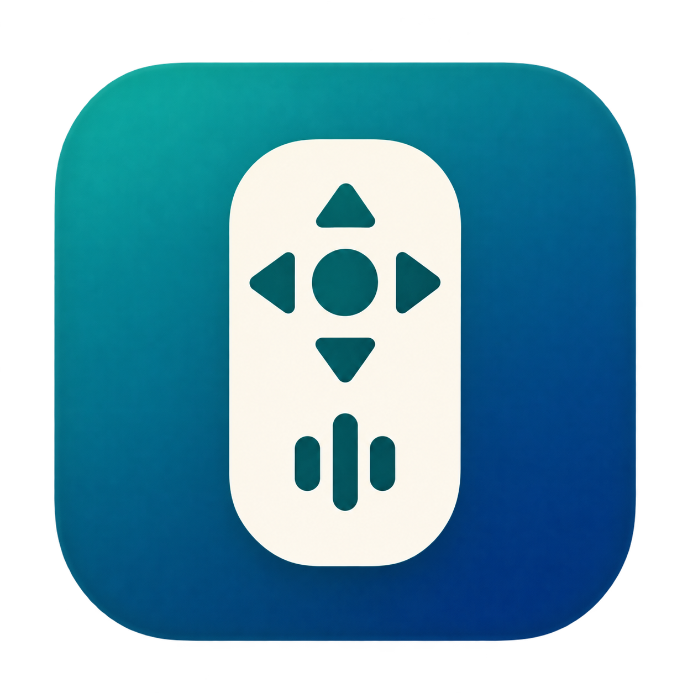
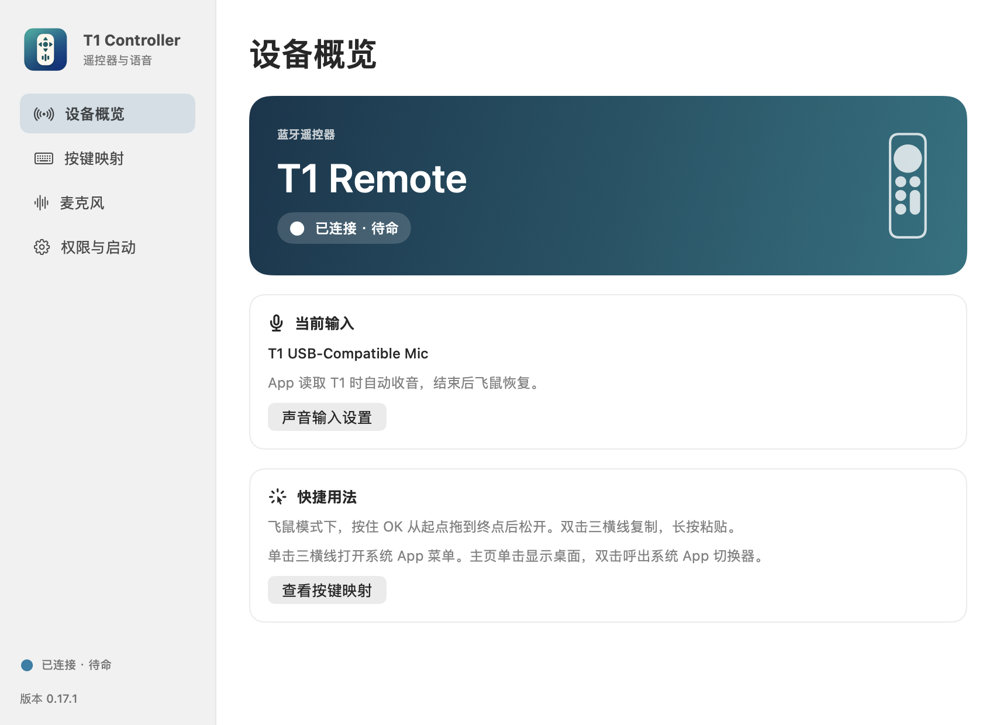
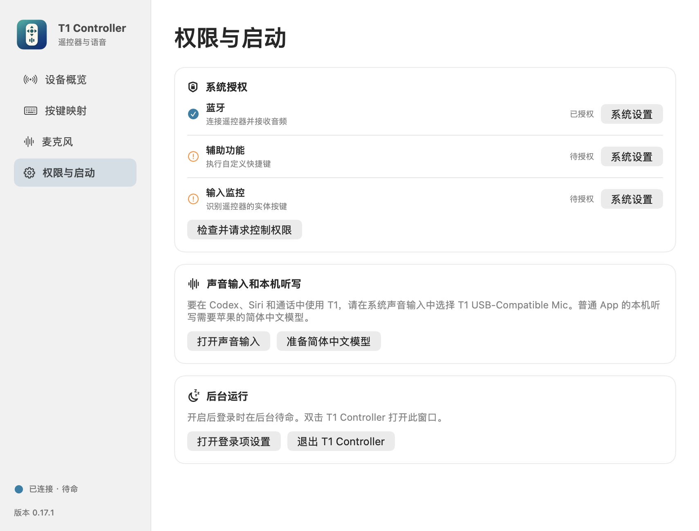
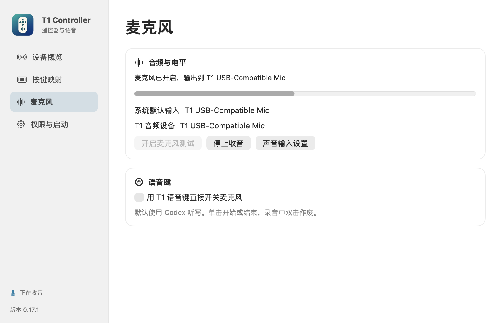
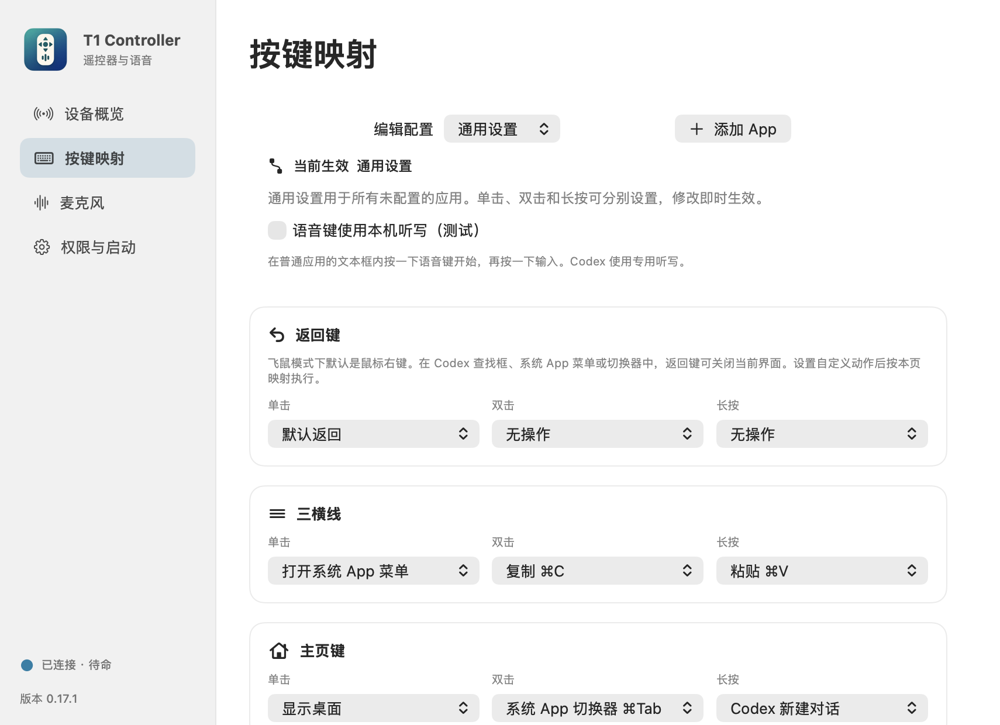
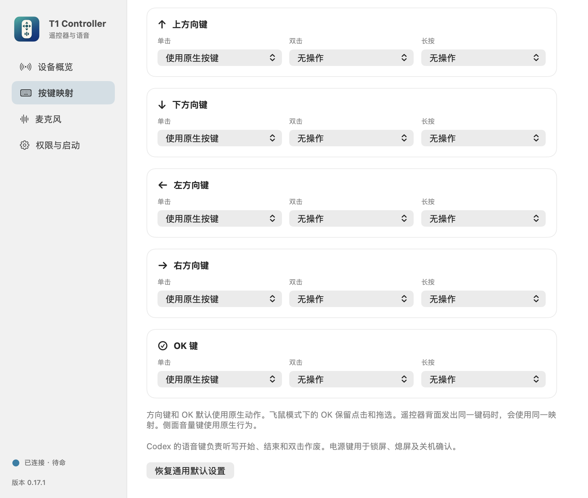
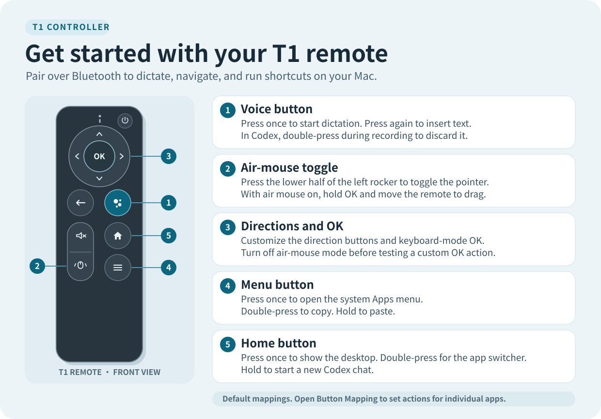

# RemoteVox

[简体中文](README.md) · **English**

Use a T1 remote over Bluetooth or a 2.4 GHz receiver as a Mac microphone, air mouse, and shortcut controller. RemoteVox supports on-device Simplified Chinese dictation, voice drafts in Codex, and per-app button mappings.

[Download v0.18.2](https://github.com/Mryang-wang/remotevox/releases/tag/v0.18.2) · [Remote quick-start poster](docs/images/quick-start-en.svg)

The app UI is in Chinese. The instructions below include the labels you will see in the app.

## 1. Install and connect

You need an **Apple silicon Mac running macOS 27 or later** and a T1 remote that supports Bluetooth or has a compatible 2.4 GHz receiver. Installing the Core Audio driver requires an administrator account.

1. Download `RemoteVox-0.18.2-arm64.pkg` and its matching `.sha256` file from [Release v0.18.2](https://github.com/Mryang-wang/remotevox/releases/tag/v0.18.2). The package contains the app and the compatible audio driver.
2. Open the package and restart when prompted. The app goes to `/Applications/RemoteVox.app` and the driver to `/Library/Audio/Plug-Ins/HAL/T1SiriInput.driver`.
3. Open **RemoteVox** from Applications. For Bluetooth, pair **T1-Remote** under **System Settings → Bluetooth** and grant the app Bluetooth access. For 2.4 GHz, plug in the receiver and switch the remote to 2.4 GHz.
4. Under **Device Overview → Connection (设备概览 → 连接方式)**, choose **Automatic (Bluetooth first)**, **Bluetooth**, or **2.4G**. A manual choice tells the app which connection to use. Battery percentage is available over Bluetooth.

The prerelease installer has yet to be notarized by Apple. If macOS blocks it, check that it came from the Release above and run `shasum -a 256 -c RemoteVox-0.18.2-arm64.pkg.sha256` in your download folder. After the checksum passes, follow the system prompt if it offers **Open Anyway**. [Apple’s instructions for opening apps safely](https://support.apple.com/en-us/102445)

Moving from an earlier test build

Upgrading from T1 Controller keeps your button mappings and settings. Quit the old app before installing. If it was set to launch at login, check **Permissions & Startup (权限与启动)** in RemoteVox after upgrading.

Early test builds lived in `~/Applications`. Before installing the system-wide version, quit the old app, move it out of that folder, and disable its login item. If the old task uses `~/Library/LaunchAgents/local.codex.t1microphone.login.plist`, move that file and log back in. Check permissions after opening the new app.

## 2. Grant permissions and select the audio input

Open **Permissions & Startup (权限与启动)** in RemoteVox and click **Check and request permissions (检查并请求控制权限)**. In **System Settings → Privacy & Security**, check the following permissions for RemoteVox.

| Permission | What RemoteVox uses it for |
| --- | --- |
| Bluetooth | Connects to the remote and receives microphone audio |
| Accessibility | Runs shortcuts, controls Codex dictation, and inserts text |
| Input Monitoring | Detects presses from the physical T1 buttons |
| Microphone | Reads audio from the 2.4 GHz receiver. macOS asks on first use. |

Quit and reopen the app if macOS asks. Click **Open Sound Input (打开声音输入)** and select **T1 USB-Compatible Mic** under **Sound → Input**. Keep your usual speaker or headphones selected under **Output**. If Codex or a calling app asks to use the microphone, grant access to that app separately.

For background startup, click **Enable at Login (开启登录启动)** under **Permissions & Startup** and follow the macOS prompt. Double-click RemoteVox whenever you need to reopen settings.

## 3. Dictate with the remote

### On-device dictation in ordinary apps

1. Under **Permissions & Startup**, click **Prepare Simplified Chinese Model (准备简体中文模型)**. macOS downloads the model on first setup.
2. Open **Button Mapping → General (按键映射 → 通用设置)** and enable **Use the voice button for on-device dictation (语音键使用本机听写（测试）)**.
3. Click an editable field in an app such as TextEdit. **Press the voice button once**, then speak when the waveform appears at the bottom of the screen. It becomes a steady line of dots in silence.
4. **Press the voice button again** to finish and insert the recognized text into the original field.

Simplified Chinese dictation in ordinary apps runs on your Mac. RemoteVox processes the audio and transcript in memory.

### Voice drafts in Codex

Switch to a Codex chat and click the composer. **Press once to start**, speak, then **press again to finish**. The transcript stays in the draft. Quickly double-press during recording to discard that recording.

**Use T1 voice button to toggle microphone directly (用 T1 语音键直接开关麦克风)** on the **Microphone (麦克风)** page is a separate capture mode. Keep it off when using the dictation gestures above.

## 4. Customize buttons

1. Open **Button Mapping (按键映射)**. Choose **General (通用设置)** for defaults across apps, or click **Add App (添加 App)** to create a profile for one app.
2. Find the button and pick an action for **Single Press (单击)**, **Double Press (双击)**, or **Long Press (长按)**.
3. To record a keyboard shortcut, choose **Custom Shortcut (自定义快捷键)** and press the combination in the recorder. For example, in a TextEdit profile, set **Up → Double Press** to `⌘F`. Switch back to TextEdit and double-press Up to open Find.
4. An app profile can **inherit the general settings (继承通用设置)** or use **Native Mode (原生模式)**. The active profile follows the frontmost app.

The direction buttons and keyboard-mode OK use their native actions by default. When mapping only a double or long press, you can leave the single press set to **Use native key (使用原生按键)**. **OK clicks and drags in air-mouse mode**. Turn off air-mouse mode with the lower half of the left rocker before testing a custom OK action. Front and rear buttons share a mapping when they send the same key code.

To control Codex with OK, select the ChatGPT (Codex) app profile in **Button Mapping (按键映射)** and set **OK → Single Press** to **Codex Send / Stop / Resume (Codex 发送／停止／继续)**. Press OK to send a draft, or to activate **Stop** or **Resume** when that button appears in the composer.

## Remote quick reference

[Open the full-size poster](docs/images/quick-start-en.svg)

| Button | Single press | Double press | Long press |
| --- | --- | --- | --- |
| Voice | Start or finish dictation | Discard current Codex recording | — |
| Menu | Open the system Apps menu | Copy | Paste |
| Home | Show desktop | Open the system app switcher | Start a new Codex chat |
| Back | Close the system Apps menu, app switcher or Codex Find. Right-click in air-mouse mode | Configurable | Configurable |
| Mute | Toggle mute | Configurable | Configurable |
| Up, Down, Left, Right | Native direction key, configurable | Configurable | Configurable |
| OK | Native confirm or air-mouse left-click | Configurable in keyboard mode | Configurable in keyboard mode |
| Power (Bluetooth) | Lock screen | Lock and sleep the display | Show the shutdown confirmation |

## Troubleshooting

- **Waiting for T1.** Wake the remote, check that `T1-Remote` is connected in Bluetooth settings, and check the app’s Bluetooth permission. For 2.4 GHz, plug in the receiver, switch the remote to 2.4 GHz, and press a button.
- **T1 input is missing.** Restart after installing, then look for `T1 USB-Compatible Mic` under **Sound → Input**.
- **The waveform moves, but no text appears.** Prepare the Simplified Chinese model, enable general dictation, and keep focus in the same editable field. For Codex, check the default audio input and Codex’s microphone permission.
- **OK still clicks the mouse.** Turn off air-mouse mode to test the keyboard-mode OK mapping.

## Build and license

Install Xcode Command Line Tools with the macOS 27 SDK. Run `./test.sh`, `./build.sh`, and `./package.sh` from the repository root. The app, installer and SHA-256 checksum are written to `Build/`. The local signing identity is stored under the current user’s Application Support directory.

The app source, scripts and documentation are under [MIT](LICENSE). The T1SiriInput audio driver is based on Existential Audio’s BlackHole source and is under [GNU GPL v3](Driver/LICENSE). [Driver source and build details](Driver/README.md) · [BlackHole upstream](https://github.com/ExistentialAudio/BlackHole)
