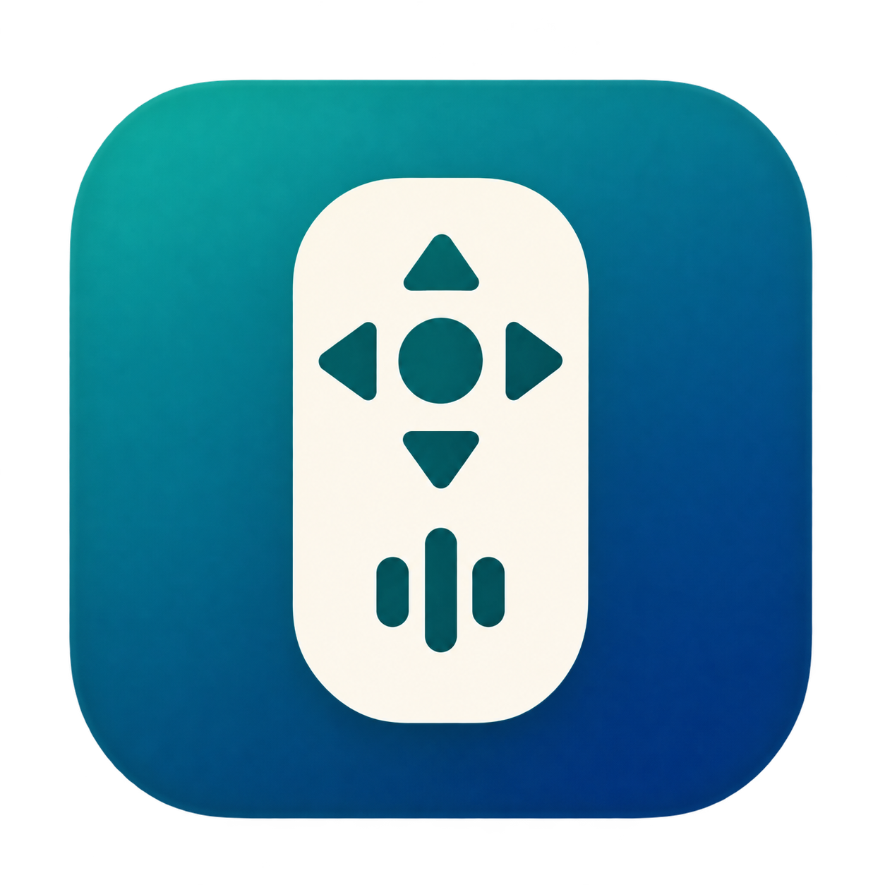
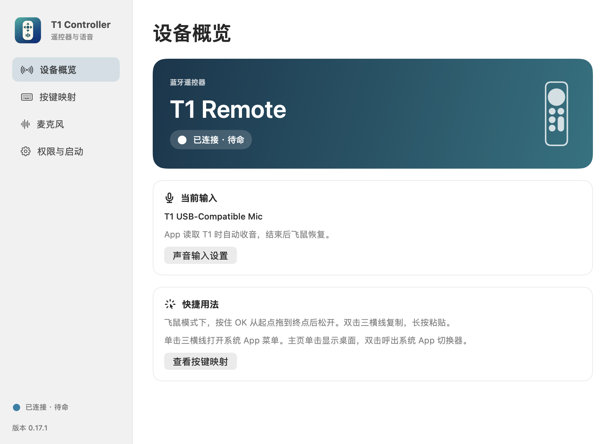
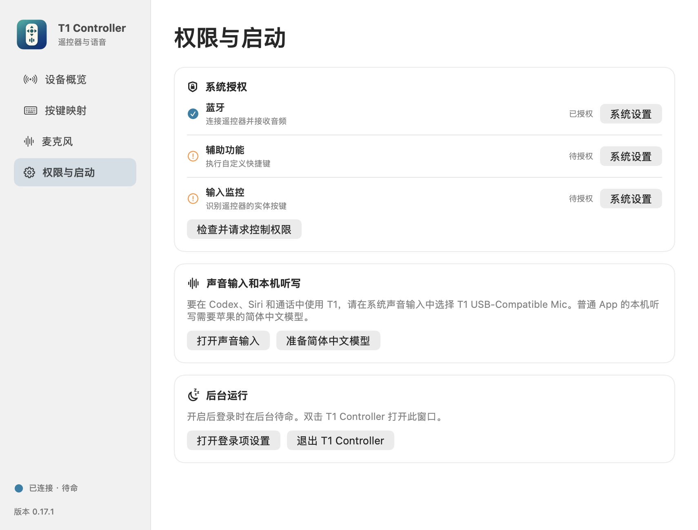
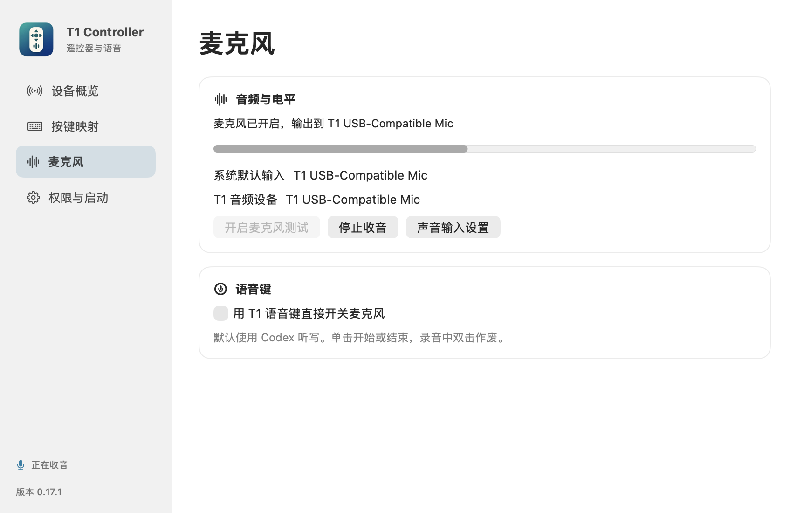
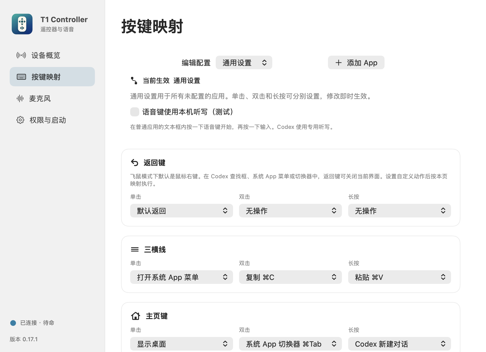
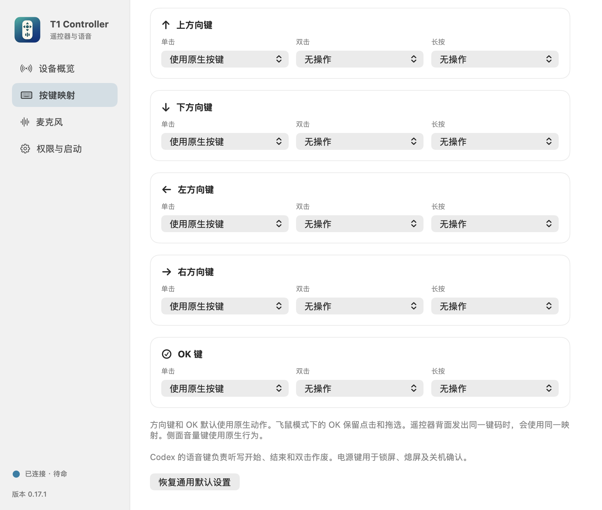
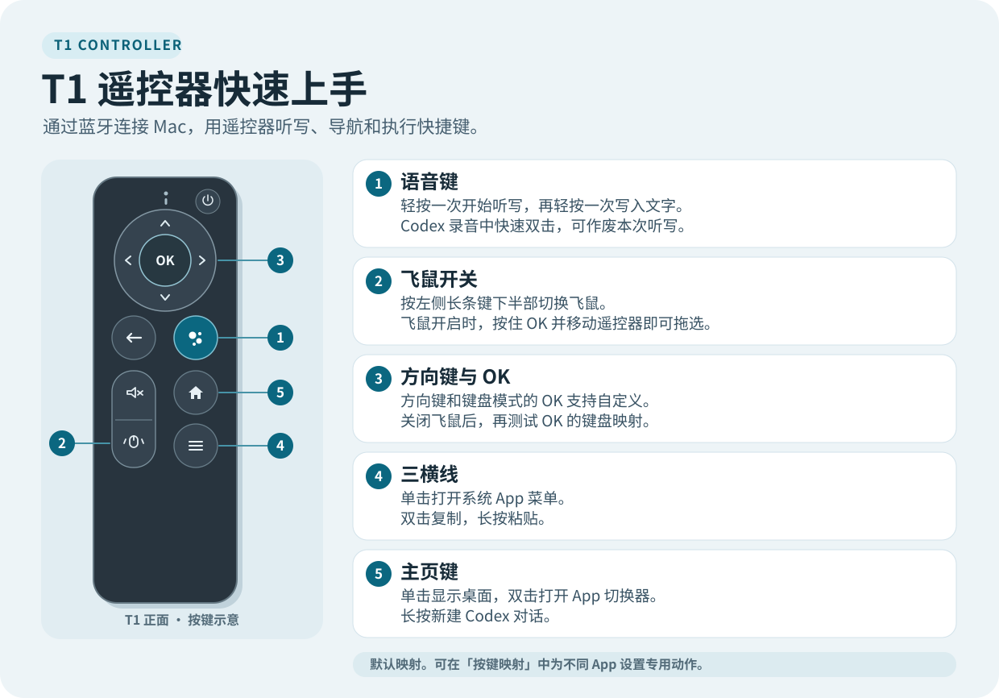

# T1 Controller

**简体中文** · [English](README.en.md)

把蓝牙 T1 遥控器用作 Mac 的麦克风、飞鼠和快捷键控制器。支持简体中文本机听写、Codex 草稿听写和逐 App 按键映射。

[下载安装包 v0.17.1](https://github.com/Mryang-wang/t1-controller/releases/tag/v0.17.1) · [遥控器快速上手图](docs/images/quick-start-zh.svg)

## 1. 安装并连接

需要 **Apple Silicon Mac、macOS 27 或更新版本**和可通过蓝牙连接的 T1 遥控器。安装 Core Audio 驱动需要管理员权限。

1. 从 [v0.17.1 Release](https://github.com/Mryang-wang/t1-controller/releases/tag/v0.17.1) 下载 `T1-Controller-0.17.1-arm64.pkg` 和同名 `.sha256` 文件。安装包包含 App 和兼容音频驱动。
2. 打开安装包并按提示重启。App 安装到 `/Applications/T1 Controller.app`，驱动安装到 `/Library/Audio/Plug-Ins/HAL/T1SiriInput.driver`。
3. 打开「系统设置 → 蓝牙」，让遥控器进入配对状态，连接 **T1-Remote**。打开「应用程序」里的 **T1 Controller**，允许蓝牙访问。

此测试安装包尚未经过 Apple 公证。如果 macOS 拦截，先确认来自上述 Release，并在下载目录运行 `shasum -a 256 -c T1-Controller-0.17.1-arm64.pkg.sha256`。校验通过后，如系统提供「仍要打开」，可按提示确认。 [Apple 的安全打开说明](https://support.apple.com/zh-cn/102445)

从早期测试版迁移

早期测试版位于 `~/Applications`。安装到系统「应用程序」前，先退出旧版、移走旧 App 并停用它的登录项。如旧任务使用 `~/Library/LaunchAgents/local.codex.t1microphone.login.plist`，移走该文件后重新登录。打开新版后核对授权状态。

## 2. 授权并选择声音输入

打开 T1 Controller 的「**权限与启动**」，点「**检查并请求控制权限**」。在「系统设置 → 隐私与安全性」中为 T1 Controller 确认以下权限。

| 权限 | 用途 |
| --- | --- |
| 蓝牙 | 连接 T1 并接收麦克风音频 |
| 辅助功能 | 执行自定义快捷键、控制 Codex 听写和写入文本框 |
| 输入监控 | 识别 T1 遥控器的实体按键 |

系统要求退出并重新打开 App 时，按提示操作。然后点「**打开声音输入**」，在「声音 → 输入」选择 **T1 USB-Compatible Mic**。在「输出」保留平时使用的扬声器或耳机。Codex 或通话 App 首次读取麦克风时，按系统提示为对应 App 授权。

如果希望登录后自动待命，在「权限与启动」点「**开启登录启动**」，并按 macOS 提示确认。双击 T1 Controller 可再次打开设置。

## 3. 使用语音输入

### 普通 App 的本机听写

1. 在「权限与启动」点「**准备简体中文模型**」。首次准备由 macOS 联网下载模型。
2. 在「按键映射 → 通用设置」开启「**语音键使用本机听写（测试）**」。
3. 打开 TextEdit（文本编辑）等 App，点进可编辑文本框。**轻按一次语音键**，看到底部波纹后说话。安静时波纹显示为静止点线。
4. **再轻按一次**结束。识别结果写入原文本框。

普通 App 的简体中文听写在本机完成。T1 Controller 在内存中处理语音和文字。

### Codex 草稿听写

切到 Codex 对话，点进输入框。**轻按一次开始**，说完后**再轻按一次结束**，文字留在草稿。录音中快速双击可作废本次听写。

「麦克风」页的「**用 T1 语音键直接开关麦克风**」是单独的收音模式。使用上面的听写手势时，让这个开关保持关闭。

## 4. 自定义按键

1. 打开「**按键映射**」。选择「通用设置」可为所有 App 设置默认动作。点「**添加 App**」并选择应用，可单独配置前台行为。
2. 找到要设置的键，在「**单击、双击、长按**」中选一个手势，再选择动作。
3. 选择「**自定义快捷键**」时，在录入窗口按下所需的组合键。例如，在 TextEdit 的配置中把「上方向键 → 双击」设为 `⌘F`，再切回 TextEdit 双击上键打开查找。
4. 单 App 配置可选择「**继承通用设置**」或开启「**原生模式**」。设置保存后，切换前台 App 会自动切换配置。

方向键和键盘模式下的 OK 默认使用原生按键。只改双击或长按时，可以把单击保留为「使用原生按键」。**飞鼠模式下的 OK 用于点击和拖选**。测试 OK 的自定义动作时，先按遥控器左侧长条键下半部关掉飞鼠。前后按键发出相同键码时，共用映射。

## 遥控器快速参考

[打开大图](docs/images/quick-start-zh.svg)

| 按键 | 单击 | 双击 | 长按 |
| --- | --- | --- | --- |
| 语音 | 开始或结束听写 | Codex 录音中作废本次听写 | — |
| 三横线 | 打开系统 App 菜单 | 复制 | 粘贴 |
| 主页 | 显示桌面 | 系统 App 切换器 | Codex 新建对话 |
| 返回 | 关闭系统 App 菜单、切换器或 Codex 查找。飞鼠模式下可右击 | 可配置 | 可配置 |
| 静音 | 切换静音 | 可配置 | 可配置 |
| 上、下、左、右 | 原生方向键，可配置 | 可配置 | 可配置 |
| OK | 原生确认或飞鼠左键 | 键盘模式下可配置 | 键盘模式下可配置 |
| 电源 | 锁屏 | 锁屏并熄屏 | 弹出关机确认 |

## 常见问题

- **App 显示等待 T1。** 唤醒遥控器，在蓝牙设置确认 `T1-Remote` 已连接，再检查 App 的蓝牙权限。
- **找不到 T1 输入设备。** 安装后先重启，再在「声音 → 输入」查找 `T1 USB-Compatible Mic`。
- **有波纹，但没有文字。** 确认已准备简体中文模型、已开启通用听写，并让光标留在原来的可编辑文本框。Codex 则检查默认声音输入和它自己的麦克风权限。
- **OK 仍然点击鼠标。** 关掉飞鼠后再测试键盘模式下的 OK 映射。

## 构建与许可证

安装带 macOS 27 SDK 的 Xcode Command Line Tools，在仓库根目录运行 `./test.sh`、`./build.sh` 和 `./package.sh`。App、安装包和 SHA-256 校验文件输出到 `Build/`。本地签名身份保存在当前用户的应用支持目录。

应用源码、脚本和文档采用 [MIT](LICENSE)。T1SiriInput 音频驱动基于 Existential Audio 的 BlackHole 源码，采用 [GNU GPL v3](Driver/LICENSE)。 [驱动源码及构建说明](Driver/README.md) · [BlackHole 上游](https://github.com/ExistentialAudio/BlackHole)
